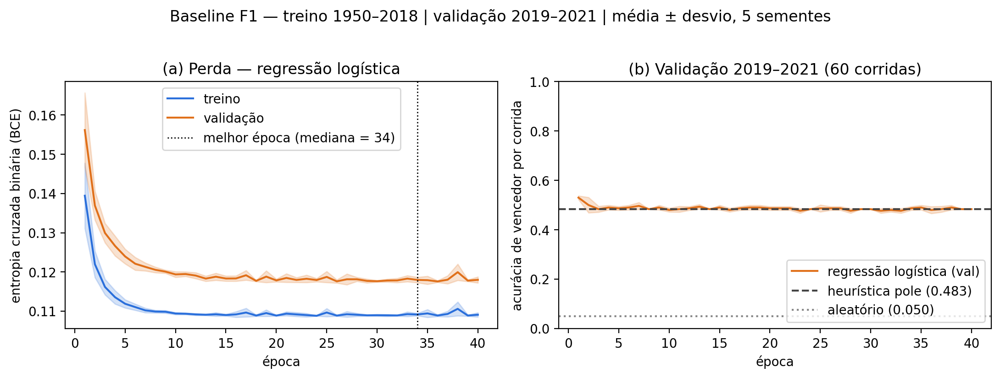

# M2 — Baseline rodando (Previsão do vencedor de corridas de F1)

Grupo: Gustavo Salmazo da Silva, Gustavo Henrique Baliero Lima

**Figura 1.** (a) BCE de treino e validação por época (média ± desvio de 5 sementes); (b) acurácia de vencedor por corrida na validação, contra a heurística da pole e o sorteio aleatório.

**Parágrafo.** Usamos o dataset público do Kaggle *Formula 1 World Championship (1950–2024)* (rohanrao), com divisão estritamente temporal: treino 1950–2018 (24 200 linhas, 997 corridas), validação 2019–2021 (1 200 linhas, 60 corridas); o teste (2022–2024) não foi tocado. A métrica é a acurácia de vencedor por corrida (top-1: em cada corrida o modelo escolhe um piloto e acerta se ele venceu), pois ~96 % das linhas são "não vence". O baseline é duplo e usa só informação pré-corrida: (i) a heurística "a pole vence", que obtém 0,483 na validação, e (ii) uma regressão logística (um neurônio sigmoide em PyTorch, Adam, 40 épocas, checkpoint na melhor BCE de validação) sobre a posição de largada e a fração de pontos da equipe no campeonato antes da prova, que obtém **0,490 ± 0,009** (média ± desvio de 5 sementes; BCE de validação 0,1171 ± 0,0001), contra 0,050 de um palpite aleatório. A regressão logística praticamente empata com a pole (Δ = +0,007, dentro da dispersão); como a validação tem apenas 60 corridas, o erro-padrão da acurácia é de cerca de 6,5 p.p., então diferenças menores que isso não são conclusivas. O tempo de execução (dados + pré-processamento + treino de 5 sementes) foi de **{TEMPO_TOTAL} s** em {AMBIENTE_COLAB}. Este é o ponto de comparação que o MLP/XGBoost deverá superar em pelo menos 5 % (critério de empate do M1) no M3.
